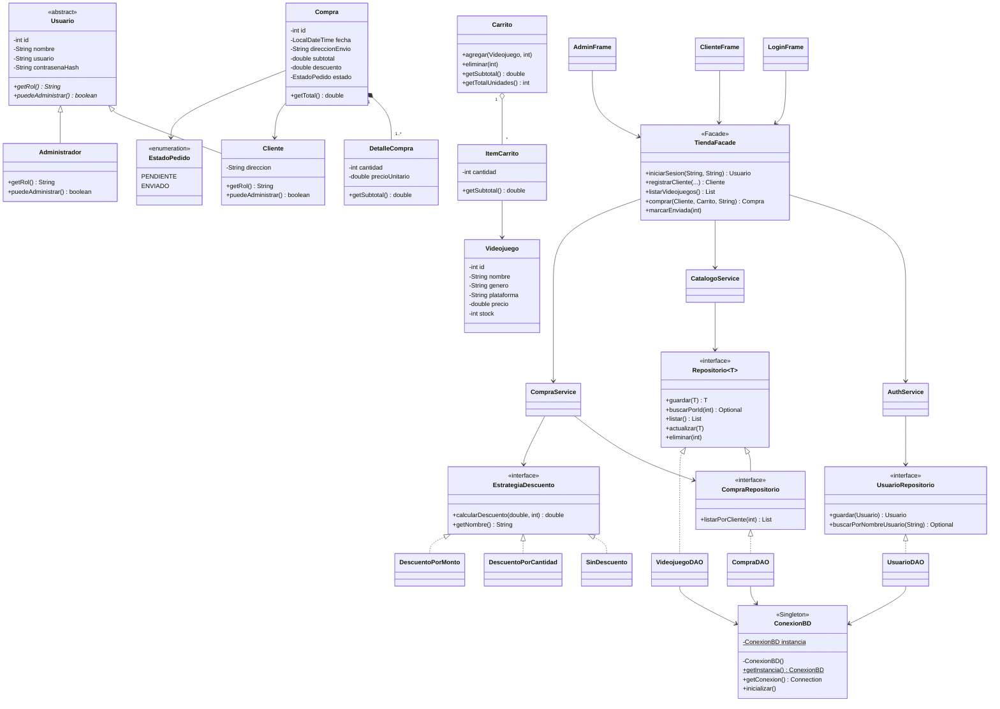
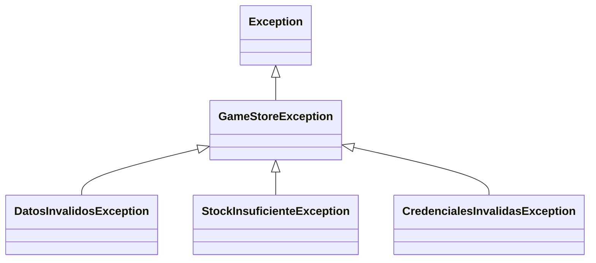
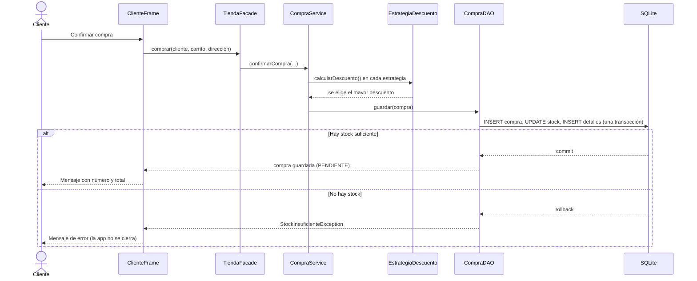
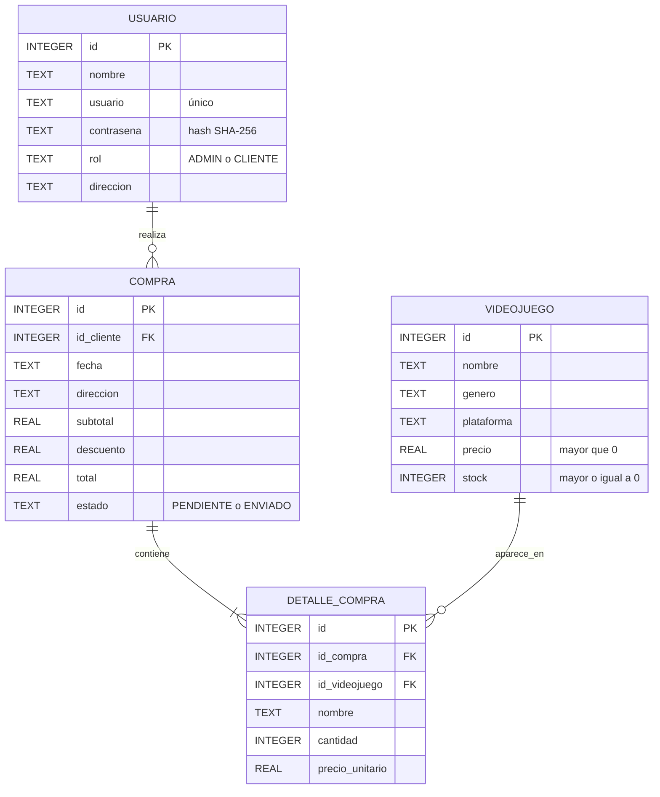

# Documentación del proyecto — GameStore

Proyecto final de **Programación 1** · Universidad Libre · Docente: Andrés Castaño

## 1. Descripción

GameStore es una aplicación de escritorio en Java para vender **videojuegos físicos** (disco o cartucho) por internet.
El cliente busca juegos en el catálogo, los agrega al carrito, escribe su dirección y confirma la compra. El
administrador gestiona el catálogo y el inventario, y marca los pedidos como enviados.

Como los productos son físicos y se envían a domicilio, el sistema maneja **stock** (unidades en inventario),
**dirección de envío** y **estado del pedido** (PENDIENTE o ENVIADO).

## 2. Tecnologías

| Herramienta | Uso |
|---|---|
| Java 17+ | Lenguaje del proyecto |
| Swing | Interfaz gráfica |
| SQLite + JDBC | Base de datos local (archivo `gamestore.db`) |
| Maven | Compilación y dependencias (driver `sqlite-jdbc`) |
| Git y GitHub | Control de versiones y entrega |

## 3. Roles y funcionalidades

| Rol | Funcionalidades |
|---|---|
| **Cliente** | Registrarse · Iniciar sesión · Buscar en el catálogo por nombre, género o plataforma · Agregar y quitar juegos del carrito · Ver el descuento aplicado · Confirmar la compra con dirección de envío · Consultar sus pedidos y su estado |
| **Administrador** | Iniciar sesión · Agregar, modificar y eliminar videojuegos · Cambiar el stock · Ver todos los pedidos con su detalle y dirección · Marcar pedidos como enviados |

Usuario administrador de prueba: `admin` / `admin123`.

## 4. Reglas del negocio

1. No se pueden agregar al carrito más unidades que el stock disponible.
2. Al confirmar la compra se guarda el pedido y se descuenta el stock en **una sola transacción**: si algo falla, no se guarda nada.
3. Descuentos (se aplica el mayor, no se suman):
   - **10 %** al comprar 3 o más unidades.
   - **5 %** si el subtotal es de $150 o más.
   - Si no aplica ninguno, no hay descuento.
4. Todo pedido nuevo queda en estado **PENDIENTE**; solo el administrador lo puede pasar a **ENVIADO**.
5. No se puede eliminar un videojuego que ya tiene compras asociadas.
6. Las contraseñas se guardan como hash **SHA-256**, nunca en texto plano.

### Validaciones de datos

| Dato | Regla |
|---|---|
| Nombre del usuario | Mínimo 3 caracteres |
| Nombre de usuario | De 3 a 20 letras, números o guion bajo, sin espacios; no se puede repetir |
| Contraseña | Mínimo 4 caracteres |
| Dirección de envío | Mínimo 5 caracteres |
| Precio del videojuego | Número mayor que 0 |
| Stock del videojuego | Número entero mayor o igual a 0 |
| Nombre, género y plataforma | No pueden estar vacíos |

Si un dato no cumple la regla, la aplicación muestra un mensaje claro y **no se cierra**.

## 5. Arquitectura por capas

```
vista (Swing)  →  fachada (TiendaFacade)  →  servicio (reglas)  →  dao (SQL)  →  bd (conexión SQLite)
                                              ↑
                                     modelo · descuento · excepciones
```

| Paquete | Responsabilidad |
|---|---|
| `app` | `Main`: punto de entrada de la aplicación |
| `vista` | Ventanas Swing: `LoginFrame`, `ClienteFrame`, `AdminFrame` |
| `fachada` | `TiendaFacade`: única puerta de entrada que usan las ventanas |
| `servicio` | Reglas del negocio: `AuthService`, `CatalogoService`, `CompraService`, `Conversor` |
| `descuento` | Estrategias de descuento: `SinDescuento`, `DescuentoPorCantidad`, `DescuentoPorMonto` |
| `dao` | Interfaces de repositorio y clases DAO que ejecutan el SQL |
| `bd` | `ConexionBD`: conexión única a SQLite y creación de la base de datos |
| `modelo` | Clases del dominio: `Usuario`, `Cliente`, `Administrador`, `Videojuego`, `Carrito`, `Compra`… |
| `excepciones` | Excepciones propias del dominio |

Las ventanas nunca hablan directamente con la base de datos: todo pasa por la fachada y los servicios.

## 6. Diagrama de clases



### Excepciones propias



| Excepción | Cuándo se lanza |
|---|---|
| `GameStoreException` | Error general del sistema (por ejemplo, no se pudo conectar a la base de datos) |
| `DatosInvalidosException` | Un dato no cumple una validación (precio negativo, campo vacío, carrito vacío…) |
| `StockInsuficienteException` | Se piden más unidades de las que hay en inventario |
| `CredencialesInvalidasException` | El usuario o la contraseña no coinciden al iniciar sesión |

Cada ventana captura estas excepciones con `try/catch` y muestra el mensaje en un cuadro de diálogo.

## 7. Patrones de diseño

| Tipo | Patrón | Clase | Para qué se usa |
|---|---|---|---|
| Creacional | **Singleton** | `bd.ConexionBD` | Garantiza una sola instancia que administra la conexión a SQLite; todos los DAO la obtienen con `getInstancia()`. |
| Estructural | **Facade** | `fachada.TiendaFacade` | Las ventanas solo usan esta clase, que esconde los servicios, los DAO y la base de datos detrás de métodos simples. |
| Comportamiento | **Strategy** | `descuento.EstrategiaDescuento` y sus 3 implementaciones | `CompraService` recibe la lista de estrategias y elige la que da mayor descuento al carrito. Para agregar un descuento nuevo solo se crea otra clase. |

## 8. Principios SOLID

| Principio | Cómo se aplica |
|---|---|
| **S** — Responsabilidad única | Cada capa tiene una sola tarea: las ventanas muestran, los servicios aplican reglas y los DAO guardan. Por ejemplo, `AuthService` solo autentica y `CompraDAO` solo guarda compras. |
| **O** — Abierto/Cerrado | Un descuento nuevo se agrega creando una clase que implemente `EstrategiaDescuento`; `CompraService` no se modifica. |
| **L** — Sustitución de Liskov | `Cliente` y `Administrador` se usan donde se espera un `Usuario`, y cualquier estrategia se usa donde se espera `EstrategiaDescuento`, sin romper el programa. |
| **I** — Segregación de interfaces | Interfaces pequeñas: `UsuarioRepositorio` solo tiene los 2 métodos que usa `AuthService`; `EstrategiaDescuento` tiene 2 métodos. |
| **D** — Inversión de dependencias | Los servicios reciben interfaces en su constructor, no clases concretas. `TiendaFacade` es el único lugar donde se crean los DAO y las estrategias. |

## 9. Flujo principal: confirmar una compra



## 10. Modelo de datos



`detalle_compra` guarda el nombre y el precio del videojuego **en el momento de la compra**, para que el historial no
cambie si el administrador modifica después el catálogo.

### Script de la base de datos

El script completo está en [`src/main/resources/schema.sql`](../src/main/resources/schema.sql). La aplicación lo
ejecuta automáticamente al iniciar: crea las tablas y, la primera vez, carga 4 videojuegos de ejemplo y el
administrador de prueba. No hay que instalar ni configurar ningún motor de base de datos.

## 11. Ejecución

Las instrucciones para ejecutar el proyecto están en el [`README.md`](../README.md).
